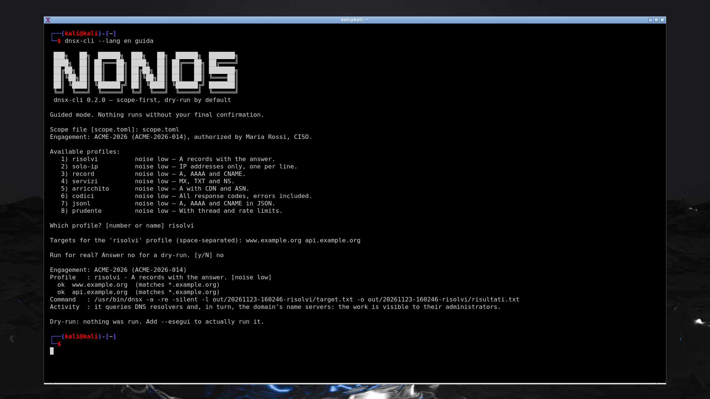
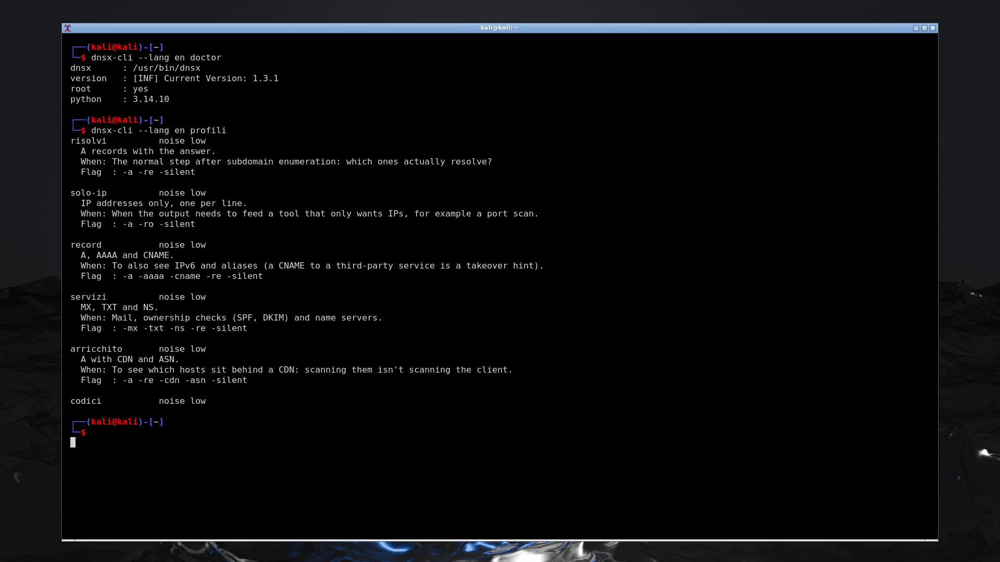
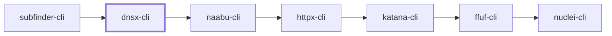

# dnsx-cli

🌐 [Italiano](README.md) · **English** · [中文](README.zh.md)

[](https://github.com/NON-OS/dnsx-cli/actions/workflows/ci.yml)


```
  ┌─ scope ─┐   ┌─ dry-run ─┐   ┌─ confirm ─┐   ┌─ dnsx ─┐   ┌─ audit ─┐   ┌─ report ─┐
  │ check   │ → │ show      │ → │ ticket    │ → │ runs    │ → │ chain   │ → │ summary  │
  └─────────┘   └───────────┘   └───────────┘   └─────────┘   └─────────┘   └──────────┘
```

Bulk DNS resolution with a validated scope, dry-run by default and a hash-chained audit. Authorized domains only.

> **Only systems you own or have written authorization for.** Read [DISCLAIMER.md](DISCLAIMER.md) before you launch anything.

## What it is

`dnsx-cli` is a thin orchestrator around ProjectDiscovery's dnsx. It does not replace dnsx. It checks that every name to resolve is in scope, blocks subdomain brute forcing, and logs every run.

Resolving names seems trivial but it is not: the queries reach the domain's name servers, and whoever runs them sees them. The delicate part is something else: dnsx takes a wordlist to generate subdomains to guess, and at that point the names being queried are ones nobody ever wrote into the scope. Here the `-d` and `-w` flags are forbidden: the names to resolve come only from a list you have already validated.

## In action



*Guided mode (`dnsx-cli guida`) running on Kali Linux: logo, profile selection, scope validation, command preview. Real screenshot.*

```console
$ dnsx-cli --lang en lancia risolvi www.example.org --scope scope.toml
Engagement: ACME-2026 (ACME-2026-014)
Profile   : risolvi - A records with the answer. [noise low]
  ok  www.example.org  (matches *.example.org)
Command   : dnsx -a -re -silent -l out/esempio/target.txt -o out/esempio/risultati.txt
Activity  : it queries DNS resolvers and, in turn, the domain's name servers: the work is visible to their administrators.

Dry-run: nothing was run. Add --esegui to actually run it.
```

With an out-of-scope target, even among valid ones, nothing runs:

```console
$ dnsx-cli --lang en lancia risolvi www.example.org 8.8.8.8 --scope scope.toml
dnsx-cli: targets out of scope, running nothing:
  8.8.8.8: not contained in any included network
$ echo $?
3
```

The `lancia` command never runs without `--esegui`. What you see above is a preview.

The output follows the language you pick: `--lang it|en|zh` or the `NONOS_LANG` variable (handy for setting it system-wide). It always starts in Italian.

## What it does

| | |
|---|---|
| Scope | Domain, host or URL (`host` mode), with exclusions and validity dates. When in doubt, it refuses. |
| Dry-run | By default nothing runs. `--esegui` asks for confirmation. |
| Profiles | 8, each marked with its noise level and when to use it. |
| Flag filter | Flags that bypass the scope or seize control of the output are blocked. |
| List filter | `filtra` reads a list from stdin and lets through only what is in scope. |
| Signed scope | The client signs the scope with their SSH key. If the file changes after signing, nothing runs. |
| Audit | Hash-chained log. Scope hash and signer included, sensitive values masked. |
| Report | Summary of results as text, Markdown or JSON. |
| Diff | What changed between two runs, with an exit code for CI. |
| Dependencies | None: just the Python standard library. |

## Platform

Built for **Kali**, **Parrot** and Linux in general: that is where these tools live and where `dnsx-cli` gets used. It also runs on macOS. Windows is untested, and there some privilege checks (`os.geteuid`) do not apply.

## Installation

You need Python 3.11 or newer and dnsx on your `PATH`. Kali/Debian: sudo apt install dnsx. Anywhere with Go: go install -v github.com/projectdiscovery/dnsx/cmd/dnsx@latest

```sh
git clone git@github.com:NON-OS/dnsx-cli.git
cd dnsx-cli
python3 -m venv .venv && . .venv/bin/activate
pip install -e .
dnsx-cli doctor
```

## First use

### The simplest way: guided mode

`dnsx-cli guida` asks you one question at a time — scope, profile, target — shows the command preview, and launches nothing without your final confirmation. It is the recommended way to start:

```sh
dnsx-cli guida
```

### Or by command

```sh
dnsx-cli init scope.toml          # crea il modello
$EDITOR scope.toml               # compilalo con il cliente
dnsx-cli verifica www.example.org --scope scope.toml
dnsx-cli lancia risolvi www.example.org --scope scope.toml            # dry-run
dnsx-cli lancia risolvi www.example.org --scope scope.toml --esegui   # parte davvero
```

In a terminal, `--esegui` asks you to type the engagement ticket. In a script, use `--conferma`. Other dnsx flags go after `--`, unless they are among the forbidden ones ([docs/04-profili.md](docs/en/04-profili.md)).

A full flow:

```sh
subfinder-cli lancia completo example.org --scope scope.toml --esegui
cat out/*-completo/risultati.txt | dnsx-cli filtra --scope scope.toml | dnsx-cli lancia risolvi - --scope scope.toml --esegui
```

## Commands

| Command | What it does |
|---|---|
| `guida` | step-by-step interactive mode: scope → profile → target → confirmation |
| `lancia <profilo> <target...>` | validates and builds (or runs) dnsx. With `-` it reads targets from stdin |
| `filtra` | reads targets from stdin and prints only those in scope |
| `verifica <target...>` | tells you whether the targets are in scope, without launching |
| `scope-firma <file>` / `scope-verifica <file>` | signs and checks the scope with an SSH key |
| `rapporto <file_or_dir>` | summary of results: DNS resolutions |
| `confronta <old> <new>` | differences between two runs |
| `profili` | lists the profiles with their exact flags |
| `audit [file]` | verifies the log's hash chain |
| `init [file]` | creates a scope file to fill in |
| `doctor` | checks dnsx, version, privileges |

## Profiles

| Profile | What it does | Noise | Root |
|---|---|---|---|
| `risolvi` | A records with the answer. | low | no |
| `solo-ip` | IP addresses only, one per line. | low | no |
| `record` | A, AAAA and CNAME. | low | no |
| `servizi` | MX, TXT and NS. | low | no |
| `arricchito` | A with CDN and ASN. | low | no |
| `codici` | All response codes, errors included. | low | no |
| `jsonl` | A, AAAA and CNAME in JSON. | low | no |
| `prudente` | With thread and rate limits. | low | no |



*`dnsx-cli doctor` (finds the real dnsx binary in `/usr/bin/`) and the profile list, on Kali Linux.*

## Exit codes

| Code | Meaning |
|---|---|
| 0 | all good |
| 1 | `confronta --exit-code` found differences |
| 2 | wrong arguments or a forbidden flag |
| 3 | at least one target out of scope |
| 4 | scope unreadable, malformed or expired |
| 5 | dnsx missing |
| 6 | run without confirmation, or a profile that needs root without sudo |
| 7 | dnsx exited with an error, or the audit chain is broken |

## The tool chain

This repository is one of eight, designed to work together. Each one checks the scope on its own.



- [subfinder-cli](https://github.com/NON-OS/subfinder-cli): subdomain enumeration
- [naabu-cli](https://github.com/NON-OS/naabu-cli): port scanning
- [httpx-cli](https://github.com/NON-OS/httpx-cli): http probes
- [katana-cli](https://github.com/NON-OS/katana-cli): web crawling
- [ffuf-cli](https://github.com/NON-OS/ffuf-cli): path fuzzing
- [nuclei-cli](https://github.com/NON-OS/nuclei-cli): vulnerability scanning
- [nmap-cli](https://github.com/NON-OS/nmap-cli): port and service scanning with nmap

## Documentation

1. [Introduction and philosophy](docs/en/01-introduzione.md)
2. [Authorization: what you need before touching a target](docs/en/02-autorizzazione.md)
3. [The scope file](docs/en/03-scope.md)
4. [Profiles and forbidden flags](docs/en/04-profili.md)
5. [The audit log](docs/en/05-audit.md)
6. [Architecture](docs/en/06-architettura.md)
7. [Where to try it safely](docs/en/07-lab.md)
8. [Reports and diffs](docs/en/08-rapporti.md)
9. [Signed scope](docs/en/09-firma.md)
10. [Compatibility and testing](docs/en/10-compatibilita.md)

The shell cheatsheet the project grew out of is in [scripts/](scripts/).

## What it does not do

It does not find out whether you have permission: you declare that in the scope file, and the program takes your word for it. It does not protect against anyone who runs `dnsx` directly. The flag filter is a safety net against mistakes, not a sandbox. The details are in [docs/06-architettura.md](docs/en/06-architettura.md).

## Development

```sh
make check     # ruff (lint + format), mypy --strict, test e coverage
```

No runtime dependencies (just the standard library). Development tools install with `pip install -e ".[dev]"`. See [CONTRIBUTING.md](CONTRIBUTING.md) and [SECURITY.md](SECURITY.md).

## License

MIT, see [LICENSE](LICENSE). The license covers the code; it does not authorize any activity.
